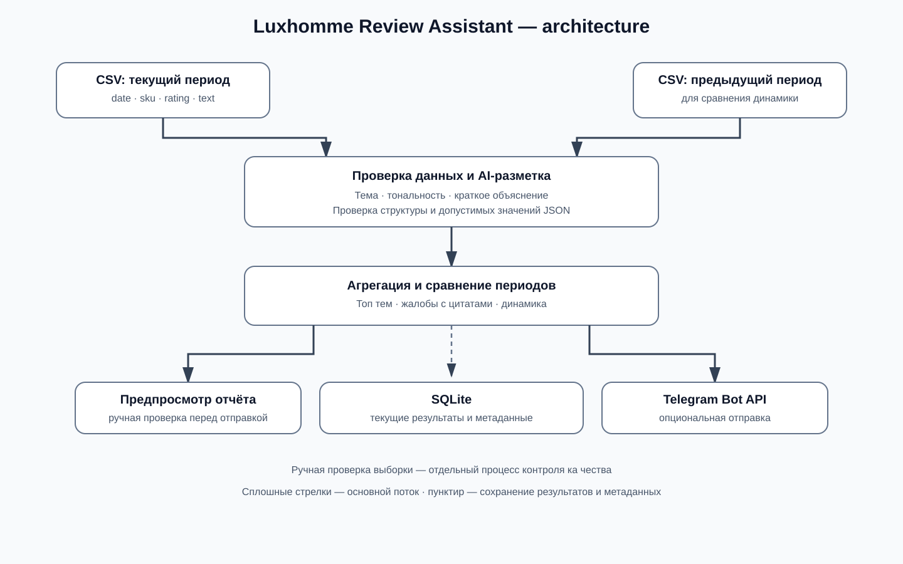

# Luxhomme Review Assistant

Небольшой прототип для анализа отзывов маркетплейсов: CSV → тема и тональность → SQLite → сводка в Telegram.

> Это тестовый прототип, а не production-сервис. Перед использованием результатов для продуктовых решений проверяйте примеры вручную. Данные в `data/` синтетические и созданы только для демонстрации.

## Возможности

- Загружает CSV с колонками `date, sku, rating, text`.
- Размечает каждый отзыв одной основной темой и тональностью (`positive`, `negative`, `mixed`) через Gemini API.
- Сохраняет результаты и метаданные разметки в SQLite.
- Считает объём, средний рейтинг, распределение тем и тональности, показывает примеры жалоб.
- Сравнивает текущую выборку с отдельным CSV предыдущего периода.
- Отправляет HTML-сводку в Telegram.
- Имеет локальный `--baseline` для проверки конвейера без API. Этот режим эвристический, не является AI и требует ручной оценки качества.

## Схема



## Быстрый запуск

Нужен Python 3.10+.

Установите зависимости из корня проекта:

```cmd
python -m pip install -r requirements.txt
```

### 1. Настройка Gemini

1. Получите API-ключ в [Google AI Studio](https://aistudio.google.com/app/apikey).
2. В корне проекта создайте файл `.env`.
3. Добавьте в него настройки:

```dotenv
GEMINI_API_KEY=ваш_gemini_api_key
GEMINI_MODEL=gemini-3.5-flash-lite
```

Замените `ваш_gemini_api_key` своим ключом. Не публикуйте `.env` и не добавляйте его в Git.

### 2. Проверить данные и запустить анализ

```bash
python main.py --input data/reviews.csv --previous data/previous_week.csv
```

По умолчанию программа печатает предпросмотр, но ничего не отправляет в Telegram. Результаты анализа сохраняются в `review_history.sqlite3`.

### 3. Настройка Telegram

1. Создайте бота через [@BotFather](https://t.me/BotFather) и получите токен.
2. Напишите боту любое сообщение, чтобы начать диалог.
3. Отправьте боту сообщение, затем откройте `https://api.telegram.org/bot<ВАШ_ТОКЕН>/getUpdates` в браузере. Найдите значение `message.chat.id` в ответе. Не публикуйте ссылку: она содержит секретный токен бота.
4. Добавьте обе настройки в тот же файл `.env`:

```dotenv
TELEGRAM_BOT_TOKEN=токен_вашего_бота
TELEGRAM_CHAT_ID=ваш_chat_id
```

Для отправки отчёта используйте флаг `--send-telegram`. Без него отчёт выводится только в консоль.

### 4. Проверка полного `.env`

Файл `.env` должен выглядеть следующим образом:

```dotenv
GEMINI_API_KEY=ваш_gemini_api_key
GEMINI_MODEL=gemini-3.5-flash-lite
TELEGRAM_BOT_TOKEN=токен_вашего_бота
TELEGRAM_CHAT_ID=ваш_chat_id
```


### 5. Проверить полный конвейер без API

```bash
python main.py --baseline --input data/reviews.csv --previous data/previous_week.csv
```

Этот режим нужен для проверки импорта, агрегации, базы и формирования отчёта без внешнего AI-сервиса. Он намеренно не отправляет сообщение, если не указан `--send-telegram`.

## Формат входного CSV

```csv
date,sku,rating,text
2026-10-22,AF-5501,5,"Готовит быстро, корзина легко моется"
```

- `date`: `YYYY-MM-DD`.
- `sku`: идентификатор товара.
- `rating`: целое число 1–5.
- `text`: текст отзыва.
- Кодировка UTF-8 / UTF-8 with BOM.

В репозитории есть две синтетические выборки: `data/reviews.csv` и `data/previous_week.csv`.

## Проверка качества AI-разметки

### Результаты пробного прогона

Прототип протестирован на синтетических отзывах с помощью `gemini-3.5-flash-lite`. Дополнительно была проверена выборка из 15 отзывов, включавшая положительные, отрицательные и смешанные оценки. Модель сформировала разметку по темам и тональности, а программа подготовила сводный отчёт.

При ручном просмотре обнаружилось, что некоторые отзывы допускают несколько обоснованных вариантов основной темы. Например, отзыв может одновременно описывать поломку товара и сложности с возвратом. Поэтому такие случаи требуют заранее согласованных правил разметки.

**Формальная точность модели пока не измерена:** для этого необходимо подготовить независимую эталонную разметку и сравнить с ней предсказания. Результаты текущего теста подтверждают работоспособность прототипа, но не доказывают точность классификации на реальных отзывах.

### Как проверять и улучшать качество

1. Случайным образом выбрать не менее 30–50 отзывов и вручную разметить их до просмотра ответов модели.
2. Сравнить предсказания с эталоном отдельно по основной теме и тональности, рассчитать долю совпадений.
3. Отдельно проверить смешанные, короткие и неоднозначные отзывы, а также случаи расхождения рейтинга с текстом.
4. Зафиксировать ошибки, уточнить таксономию и промпт, затем повторить оценку на той же и на отдельной контрольной выборке.
5. Не использовать эвристический режим `--baseline` как эталон качества AI-разметки.

Файл `docs/manual_review_template.csv` предназначен для фиксации эталонных меток, предсказаний модели и расхождений.

## Ограничения и что изменить для production

- Сейчас источник — CSV. Для промышленного запуска нужен согласованный источник отзывов, легальный доступ к API маркетплейса и обработка пагинации/лимитов.
- В прототипе сравнение недель делается между текущим CSV и отдельным CSV прошлого периода. Перед регулярным запуском нужно формально определить границы недель, часовой пояс и дедупликацию.
- SQLite подходит для локального прототипа. Для нескольких исполнителей/процессов и сервиса с мониторингом выбрать управляемую БД.
- Нужны расписание запуска, повторные попытки при временных ошибках, логирование, уведомление об ошибке и контроль стоимости/лимитов LLM.
- Нужны тесты на пустые/повреждённые строки, дубликаты, API-ошибки, некорректный JSON и слишком длинные сообщения Telegram.
- Хранить ключи только в переменных окружения или secret manager. Не записывать токены и полный текст чувствительных отзывов в логи.
- Отдельно согласовать с маркетингом таксономию тем, критичность жалоб, формат отчёта, пороги тревог и бизнес-владельца реакции на проблему.

## Решения и компромиссы

- Python без тяжёлых фреймворков: проще запускать и проверять за 10 минут.
- CSV вместо подключения к маркетплейсу: в тестовом прямо разрешены самостоятельно собранные данные; интеграция с реальным источником зависит от прав доступа.
- SQLite — минимальное локальное хранилище истории.
- Gemini вызывается одним пакетным запросом, чтобы уменьшить число API-вызовов. При большом объёме нужно дробить данные на порции и добавлять повторные попытки.
- Предпросмотр включён по умолчанию: отправка в Telegram требует явного `--send-telegram`.
- Синтетические данные показывают функциональность, но не позволяют делать выводы о реальном бренде.

## Вопросы маркетингу до запуска

1. Какие темы и подкатегории важны команде, и кто владелец каждой темы?
2. Какие маркетплейсы/SKU приоритетны и есть ли согласованный доступ к отзывам?
3. Сравниваем календарные недели или последние 7 дней? Какой часовой пояс?
4. Какой рост жалоб считать критичным и кого уведомлять?
5. Нужны ли разрезы по SKU, рейтингу, региону, версии товара или продавцу?
6. Можно ли хранить тексты отзывов во внешнем AI-сервисе, и какие требования к данным/срокам хранения?
7. Кто проверяет неоднозначные отзывы и подтверждает действия по итогам сводки?

## Безопасность

Не добавляйте в Git API-ключи, Telegram-токен, реальные персональные данные или секреты. При случайной публикации токен нужно отозвать/перевыпустить.
